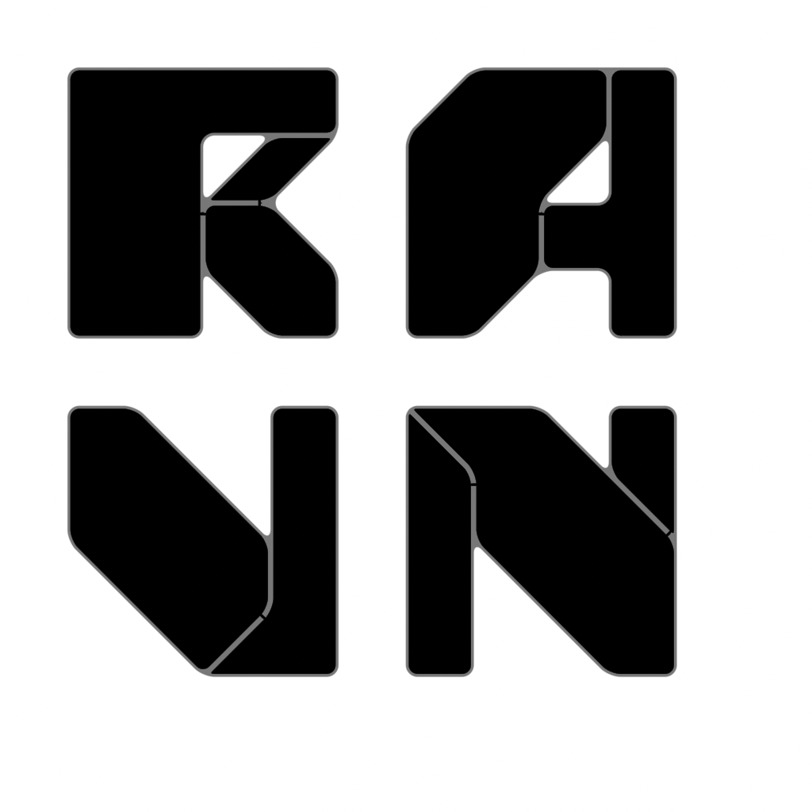

<div align="center">



(read as *raven*)

RAVN is a collection of lightweight 2D and 3D libraries for game and engine development in [Odin](https://odin-lang.org).

### [Discord Link](https://discord.com/invite/wn5jMMMYe4)

</div>

> [!WARNING]
> **EARLY ALPHA VERSION**: Not stable yet. Expect major breaking changes.


## Packages

See [Cheatsheet](./CHEATSHEET.md) for quick API overview.

- [base](base/)
- [gpu](gpu/)
- [platform](platform/)
- [audio](audio/)
- [scene](scene/)
- [shader_compiler](shader_compiler/)
- [debugdraw](debugdraw/)
- [bvh](bvh/)
- [geometry](geometry/)
- [collision](collision/)
- [imgui](imgui/)
- [input](input/)
- [entities](entities/)

# Getting Started

Install [Odin](https://github.com/odin-lang/Odin) and make sure it's in your path. Check the [Official Install docs](https://odin-lang.org/docs/install/) for more info. The main RAVN branch should always compile on the latest Odin master branch.

## Project Setup
The recommended approach is using [git subtrees](https://github.com/git/git/blob/master/contrib/subtree/git-subtree.adoc), a nicer alternative to submodules or manual copy-pasting.

Here are the commands to clone the library into your project, and to pull the latest upstream changes. It will appear just as a regular directory.
```
git subtree add --prefix=ravn https://github.com/jakubtomsu/ravn main --squash
git subtree pull --prefix=ravn https://github.com/jakubtomsu/ravn main --squash
```

## Examples

You can run demos from the [examples/](examples) directory with something like the following command:
```
odin run examples\hello
```

# Contributing

Most wanted type of contributions is bugfixes. Both Issues and PRs are acceptable.
Please include `odin report` output and a code sample to reproduce the issue if applicable.

If you want a new feature, it is recommended to discuss it on Discord first.

### Code style

- Keep things simple
- Ensure coherency with the rest of the code
- Use the default Odin [naming conventions](https://github.com/odin-lang/Odin/wiki/Naming-Convention)
