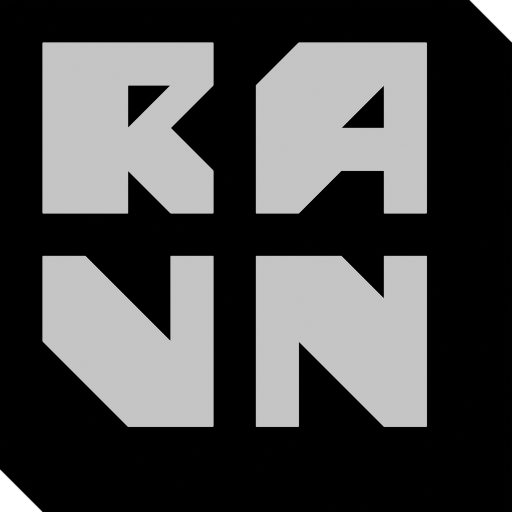

<div align="center">



(pronounced *raven*)

RAVN is a lightweight 2D and 3D engine for the joy of game development in [Odin](https://odin-lang.org).

### [Discord Link](https://discord.com/invite/wn5jMMMYe4)

</div>

> [!WARNING]
> ***EARLY ALPHA VERSION***
>
> Do NOT use for anything serious yet. Major features aren't fully finished and might break. There will be large breaking API changes.
>
> Windows is stable, but WASM+WebGPU or Linux builds might have bugs.


## Principles
A game library made specifically for small indie teams and fast iteration times.
Something *simple* you can prototype in, but also *stable* enough to make polishing a full game straightforward.

- Batteries-included
- Simple and hackable
- Minimal dependencies
- Zero hidden internal state
- Modular architecture

> Inspired by Sokol, PICO8 and Raylib.

## Simple Example

```odin
import rv "ravn"
// Export app info to allow for hot reloading
@export _app_desc := rv.App_Desc{update = _update}

main :: proc() {
    rv.run_main_loop(_app_desc)
}

_update :: proc(_: rawptr) -> rawptr {
    if rv.key_pressed(.Escape) { rv.request_shutdown() }
    // Initialize camera for layer 0
    rv.update_draw_layer(0, rv.make_screen_camera(rv.get_screen_size()))
    // Set up draw state
    rv.set_draw_texture(rv.get_builtin_texture(.CGA8x8thick))
    rv.draw_text_2d("Hello World! ☺", {100, 100}, scale = 4, spacing = 1)
    // Tell the GPU to render layer 0 to default render target
    rv.render_layer(0, clear_color = rv.DARK_BLUE.rgb, clear_depth = true)
    return nil
}
```

# Getting Started

## Prequisities
Install [Odin](https://github.com/odin-lang/Odin) and make sure it's in your path. Check the [Official Install docs](https://odin-lang.org/docs/install/) for more info.

The main branch here should always compile on the latest Odin master branch build.

There are no additional dependencies.

## Project Setup
The recommended approach is using [git subtrees](https://github.com/git/git/blob/master/contrib/subtree/git-subtree.adoc), a nicer alternative to submodules or manual copy-pasting.

Here are the commands to clone the library into your project, and to pull the latest upstream changes. It will appear just as a regular directory.
```
git subtree add --prefix=ravn https://github.com/jakubtomsu/ravn main --squash
git subtree pull --prefix=ravn https://github.com/jakubtomsu/ravn main --squash
```
> In case you want to delete the entire subtree, just remove the folder. There shouldn't be any hidden metadata.

## Examples

You can run demos from the [examples/](examples) directory with something like the following command:
```
odin run examples\hello
odin run build -- run_hot examples\hello
```
Try the [hello](examples/hello/hello_example.odin) or [Snake Planet game](examples/snake_planet/snake_planet_example.odin) examples!


# Docs

See [Cheatsheet](./CHEATSHEET.md) for quick API overview.

## Web builds

You can run the following command to export your game to web:
```
odin run build -- export-web my_package
```
To run the app locally, you must also create a tiny HTTP file server. VSCode live server extension or `python -m http.server <port>` is recommended.

> [!NOTE]
> In case you're having issues with rendering, you can test WebGPU is behaving correctly locally with `odin run my_package -define:GPU_BACKEND=WGPU`, however the wgpu-native used on desktop can be slightly different than the Chrome Dawn implementation.

## Cross platform shaders

The engine comes with a few built-in shaders. Those always work everywhere by default.

Compiling custom shaders is handled internally using the `shader_compiler` package when you load a shader from source.
This requires a ***slang compiler dynamic library*** on non-D3D11 builds. Install it from [slang github](https://github.com/shader-slang/slang) releases.

- Windows: copy `slang.dll` and `slang-compiler.dll` into your project
- Linux: copy `libslang-compiler.so.*` as `libslang.so` into your project.

# Contributing
For info about bug reports and contributing, see [CONTRIBUTING](CONTRIBUTING.md)

